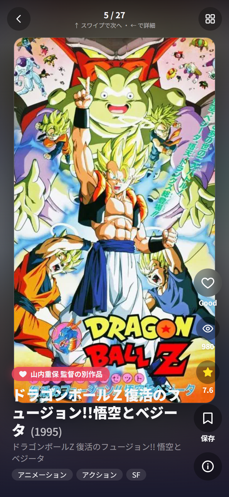
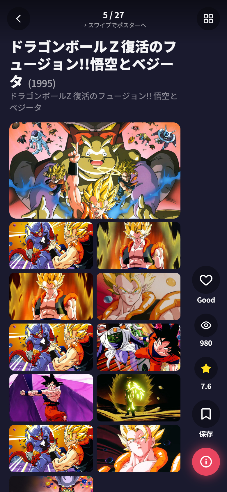
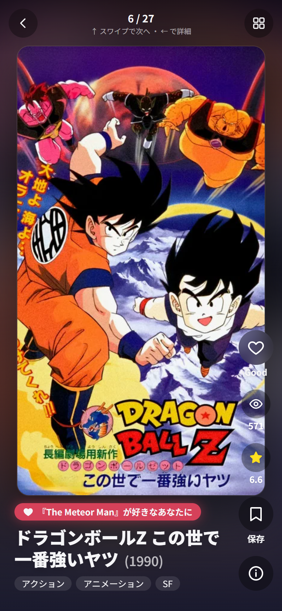
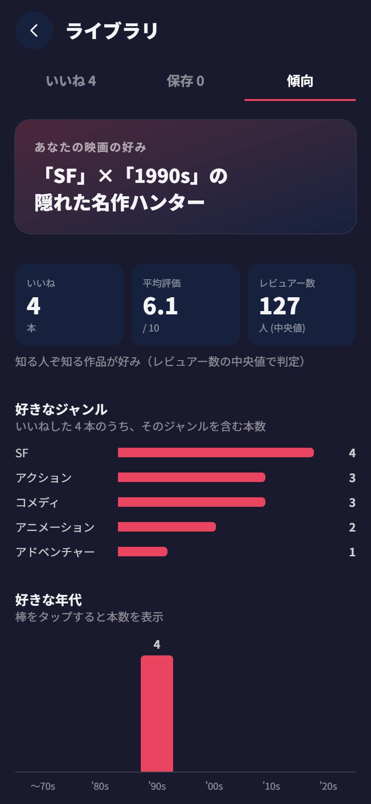

# FilMatch

[](https://github.com/kikuta1/filmatch/actions/workflows/ci.yml)

**映画を、速く、気軽に、おしゃれに探す。**
TikTok のような縦スワイプで映画を次々に眺め、「いいね」した作品から好みを学習して似た映画を出す Web アプリです。

**デモ: https://filmatch.vercel.app** （スマホでの閲覧を推奨。ホーム画面に追加するとアプリのように全画面で使えます）

<p>
  
  
  
  
</p>

## なぜ作ったか

映画を探すとき、配信サービスのおすすめは「流行っている作品」に偏りがちで、自分に合う知らない映画に出会いにくいと感じていました。
そこで、**ポスターの第一印象で直感的に選べる**こと、**人気作に偏らずに新しい作品と出会える**ことを軸に、短い時間で気軽に映画を探索できるツールを作りました。

## 主な機能

| 画面 | 内容 |
|---|---|
| フィルタリング | ジャンル（複数選択）と年代で絞り込んで探索開始 |
| 探索（ポスター） | 縦スワイプで次の映画へ。ポスターを大きく表示し、ダブルタップでいいね |
| 探索（詳細） | 横スワイプで切り替え。スチル画像のグリッド、監督・キャスト、予算・興行収入、国内の配信サービス、Filmarks へのリンク |
| ライブラリ | いいね一覧・保存一覧と、いいねから分析した**好みの傾向**（ジャンル・年代のグラフ、「隠れた名作ハンター」などのタイプ判定） |

PC ではキーボード（↑↓←→）とマウスホイールでも操作できます。
PWA に対応しており、スマホのホーム画面に追加するとブラウザの枠なしで起動します。

## 工夫した点

### 1. いいねすると、すぐ次から似た映画が出てくる
気に入った映画にいいねすると、2本先から似た映画が届き始めます。カードには「『◯◯』が好きなあなたに」「◯◯ 監督の別作品」と理由が出るので、自分の好みが伝わったことが分かります。
似た映画は1本おきに入り、間には知らない映画も挟まるので、好みに寄りすぎず新しい出会いも残ります。間違えていいねしても、取り消せばまだ見ていない分は消えます。

> **仕組み**: いいねした瞬間に TMDB の「おすすめ」「類似作品」と同じ監督の作品から4本を選び、表示待ちの列に1本おきに差し込む。新作などで似た作品のデータがない場合は、同じジャンルの組み合わせを持つ映画で代わりに探す。

### 2. いいねするほど、好みの映画が増えていく
一度に見つかった似た映画のうち、すぐに出さなかった分も取っておき、その後の映画にも混ぜていきます。いいねを重ねるほど、好みに合う映画が自然と増えていきます。

> **仕組み**: 差し込まなかった候補を「候補プール」に貯め、次の20本を作るときの「似た映画」枠（4割）に優先して使う。プールで枠が埋まれば外部 API を呼ばないので、通信量も減る。

### 3. 有名作だけでなく、知らない名作にも出会える
人気の映画ばかりが出てくると、新しい作品に出会えません。FilMatch では有名作もマイナー作も同じ確率で出てくるので、自分では探さなかった映画に出会えます。一度見た映画は二度と出てきません。

> **仕組み**: 条件に合う映画を人気順に並べた全ページから、ランダムなページを選んで取得する。

### 4. スマホの操作感を崩さない
横スワイプで詳細を開いたあと、スマホの「戻る」操作（Android の戻るボタン、iPhone の画面端からのスワイプ）をしても、アプリから出ずにポスターに戻ります。詳細をスクロールしている途中で横にスワイプしても、誤って前のページに戻りません。

> **仕組み**: 詳細を開くとブラウザの履歴に1つ積み、「戻る」でポスターに戻す。詳細のスクロール領域にも `touch-action` を指定し、横スワイプをブラウザのジェスチャーに奪われないようにした。

### 5. 公開しても安全に動く
映画データの取得に使う API キーは利用者の画面に一切出さず、外部サイトからの不正な呼び出しや大量アクセスも防いでいます。

> **仕組み**: ブラウザは自前の API Routes だけを呼び、API キーはサーバー側の環境変数にのみ置く。`proxy.ts`（Next.js 16 で middleware から改名）で CORS 制御と IP 単位のレート制限（120回/分）をかける。

### 6. 誰でもすぐに試せる
API キーを持っていなくても、クローンしてすぐに動かせます。

> **仕組み**: `TMDB_API_KEY` が未設定のときは、架空の映画データと自動生成したポスター画像で動く（画面右上に DEMO と表示）。

## 技術スタック

| 分類 | 使用技術 |
|---|---|
| フレームワーク | Next.js 16（App Router / Cache Components）, React 19 |
| 言語 | TypeScript |
| スタイル | Tailwind CSS v4 |
| アニメーション | framer-motion（スワイプ・カード遷移） |
| 状態管理 | zustand（persist で localStorage に保存） |
| データ | TMDB API v3 |
| テスト・CI | Vitest, GitHub Actions（lint・型チェック・テスト・ビルド） |
| ホスティング | Vercel |

## アーキテクチャ

```
ブラウザ (React)
  │  /api/movies/... のみを呼ぶ
  ▼
Next.js proxy.ts ── CORS 制御 / レート制限（120回/分/IP）
  ▼
Next.js API Routes ── TMDB API キー（サーバー側のみ）
  │                    "use cache" で TMDB の応答を1時間キャッシュ
  ▼
TMDB API
```

| エンドポイント | 内容 |
|---|---|
| `GET /api/movies/discover` | ジャンル・年代で絞り込んだ映画（ページ未指定ならランダム） |
| `GET /api/movies/{id}` | 詳細・クレジット・画像・配信情報を1回の TMDB 呼び出しで結合 |
| `GET /api/movies/{id}/recommendations` | おすすめ映画 |
| `GET /api/movies/{id}/similar` | 類似映画 |
| `GET /api/people/{id}/directed` | 監督作品の一覧 |
| `GET /api/movies/genres` | ジャンル一覧 |

## チーム開発と担当

3人のチームで、キックオフ・UI案の検討・要件定義を行いました。散布図で映画を探す案とスワイプで探す案を比べ、「短い時間で気軽に探せる」ことを優先してスワイプ案に決めています。
要件定義書: [docs/requirements.md](docs/requirements.md)

### 担当（菊田）
AI コーディングツール（Claude Code）に実装方法を説明してもらいながら、アプリを実装しました。
実際に使ってみて気づいたことをもとに、次のような改善を自分で判断・提案しています。

- **いいねがすぐ反映されるようにした**：最初は20本ごとにしか好みが反映されず、効いている実感がなかったため
- **似た映画をまとめて取ったら、残りも後で使うようにした**：せっかく見つかった候補を捨てるのはもったいないと考えたため
- **「似ている」の基準に監督を加え、キャストは使わないことにした**：作風が似るのは出演者より監督だと考えたため
- **差し込む本数を4本に増やし、1本おきに並べた**：2本では好みの反映が物足りず、続けて並べると知らない映画との出会いが減るため
- **好みの傾向が見られるライブラリ画面を追加した**：いいねした映画を後から振り返り、自分の好みを知れるようにするため
- **スマホで詳細から戻れなくなる不具合を見つけた**：実機で操作していて発見し、原因の調査と修正につなげた
- **就活用に無料で公開する方法を選んだ**：Vercel での公開と、ホーム画面に追加できる PWA 化

## ローカルで動かす

```bash
# Node.js 20 以上
npm install
cp .env.example .env.local   # TMDB_API_KEY を記入（空ならダミーデータで動作）
npm run dev                  # http://localhost:3000
npm test                     # 単体テスト（レート制限・パラメータ検証・レコメンドロジック）
```

TMDB の API キーは https://www.themoviedb.org/settings/api で無料で取得できます。

## 今後の展望

- ログインとサーバー側 DB による、端末をまたいだいいね・保存の同期
- すぐスキップした作品の傾向も学習に使う
- 同じシリーズ作品が続きすぎないよう、シリーズ単位で出現数を制限する

---

This product uses the TMDB API but is not endorsed or certified by TMDB.
配信情報の提供: JustWatch
